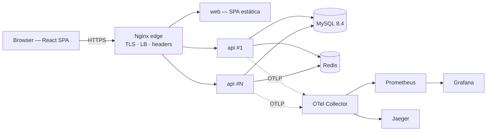

# Xyami.Park

Sistema de gestão de parque de estacionamento — check-in/check-out de viaturas, faturação por minuto,
histórico de tickets, gestão de utilizadores e auditoria. Reescrita completa do sistema PHP original
(em [`legacy/`](legacy/)) com paridade funcional, segurança corrigida e arquitetura preparada para produção.



| Camada | Tecnologia |
|---|---|
| Frontend | React 19 · TypeScript 5.9 · Vite 8 · TanStack Router/Query/Table · Tailwind 4 · shadcn/ui · RHF + Zod · motion |
| Backend | ASP.NET Core 10 Minimal APIs · Clean Architecture · CQRS (dispatcher próprio) · EF Core 10 · FluentValidation · Serilog · OpenTelemetry |
| Dados | MySQL 8.4 (migrations EF Core) · Redis 7.4 (HybridCache, rate limiting, idempotência) |
| Infra | Docker Compose · Nginx (TLS, load balancing) · Prometheus · Grafana · Jaeger · manifestos Kubernetes |
| Qualidade | xUnit + Testcontainers · Vitest + MSW · Playwright · k6 · CodeQL · Trivy · GitHub Actions |

## Arranque rápido (stack completa em Docker)

```bash
cp .env.example .env              # preencha todas as senhas/segredos (ver comentários no ficheiro)
./infra/scripts/generate-dev-certs.sh
docker compose up -d --build --wait
open https://localhost            # entre com BOOTSTRAP_ADMIN_USERNAME / BOOTSTRAP_ADMIN_PASSWORD
```

Observabilidade: `docker compose --profile observability up -d` (defina `OTEL_EXPORTER_OTLP_ENDPOINT=http://otel-collector:4317`)
→ Grafana `http://localhost:3000`, Prometheus `:9090`, Jaeger `:16686`.

## Documentação

| Documento | Conteúdo |
|---|---|
| [docs/01-discovery.md](docs/01-discovery.md) | Diagnóstico técnico do sistema legado (funcionalidades, falhas de segurança, bugs) |
| [docs/02-architecture.md](docs/02-architecture.md) | Arquitetura, decisões, contrato da API, modelo de dados, fluxos, mapeamento legado → novo |
| [docs/03-installation.md](docs/03-installation.md) | Instalação, configuração e execução (desenvolvimento, staging, produção) |
| [docs/04-operations.md](docs/04-operations.md) | Deploy/rollback, backups e recuperação, migração de dados do legado, escala, monitorização |
| [docs/05-security.md](docs/05-security.md) | Controlos de segurança e mapeamento OWASP |
| [docs/06-testing.md](docs/06-testing.md) | Estratégia e execução de testes |
| [frontend/README.md](frontend/README.md) | Estrutura e convenções do frontend |
| API (Swagger) | `https://<host>/swagger` com `OPENAPI_ENABLED=true` |

## Estrutura

```
backend/    ASP.NET Core (Domain · Application · Infrastructure · Api) + testes
frontend/   SPA React + testes (Vitest, Playwright)
infra/      nginx · mysql · redis · observability · k8s · scripts (deploy, backup, restore, certificados)
tests/load/ k6
docs/       documentação
legacy/     sistema PHP original (referência; remover após a validação em produção)
```
