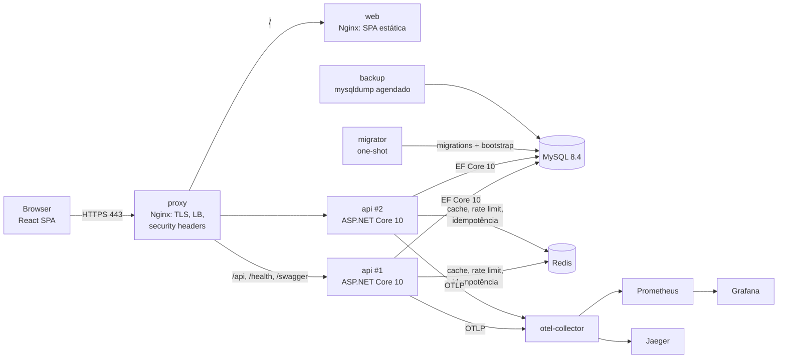
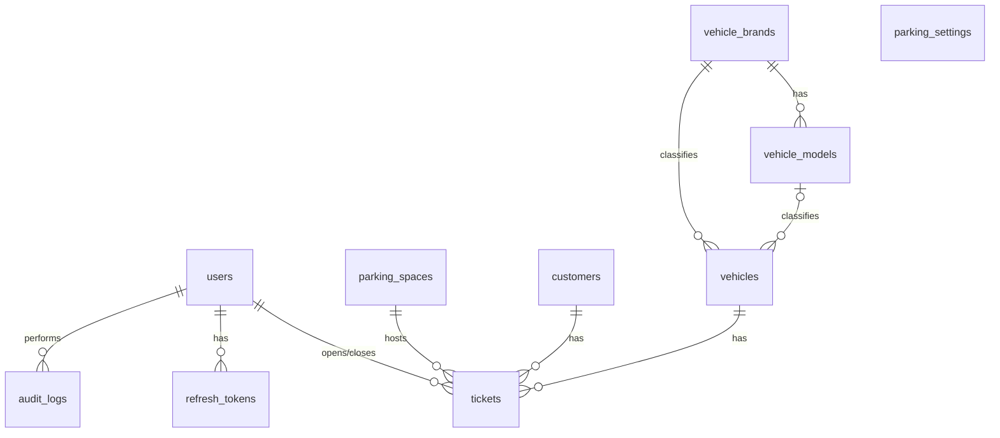
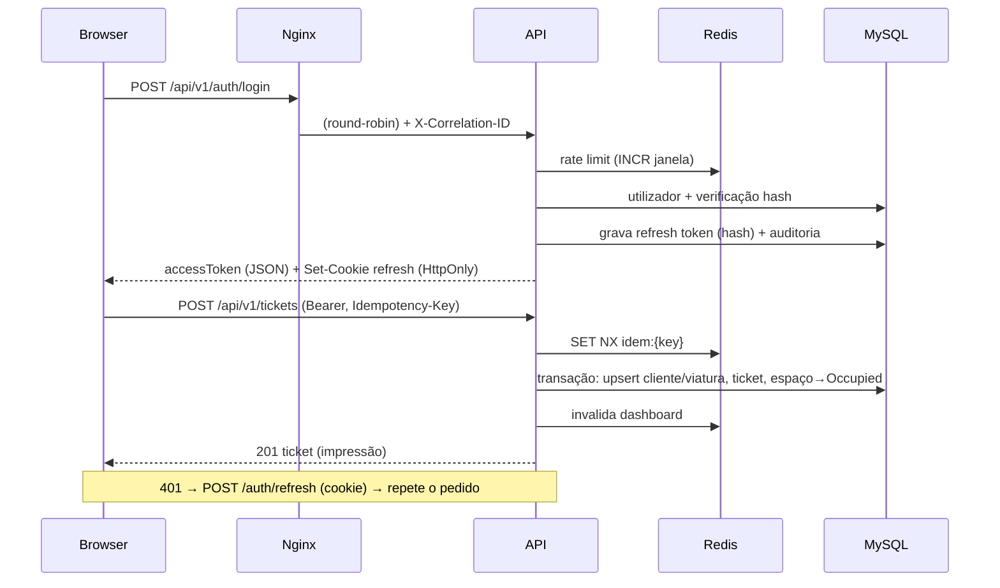

# Fase 2 — Arquitetura alvo, contratos e plano de migração

## 1. Visão geral



- **Stateless API** replicada horizontalmente atrás do Nginx (`upstream … resolve`, DNS do Docker).
- **MySQL** é a fonte de verdade. **Redis** é apenas cache/coordenação (nada se perde se for limpo).
- **Migrations** correm num contentor *one-shot* (`migrator`) antes das réplicas da API — evita corridas entre instâncias.

## 2. Estrutura do repositório

```
backend/                     ASP.NET Core 10 (Clean Architecture + CQRS)
  src/Parking.Domain/          entidades, value objects, regras (sem dependências)
  src/Parking.Application/     commands, queries, handlers, DTOs, validação, abstrações
  src/Parking.Infrastructure/  EF Core/MySQL, Redis, JWT, hashing, auditoria
  src/Parking.Api/             Minimal APIs por módulo, middleware, auth, OpenAPI, observabilidade
  tests/Parking.UnitTests/         domínio, validadores, pipeline CQRS
  tests/Parking.IntegrationTests/  API + MySQL + Redis reais (Testcontainers)
frontend/                    React 19 + TypeScript + Vite + TanStack + Tailwind + shadcn/ui
  src/routes/                  rotas (TanStack Router, file-based, code splitting automático)
  src/features/<módulo>/       api (query options/mutations), schemas Zod, componentes
  src/components/ui/           design system (shadcn/ui + Radix)
  e2e/                         Playwright
infra/
  nginx/  mysql/  redis/  observability/  k8s/  scripts/
tests/load/                  k6
docs/                        esta documentação
legacy/                      código PHP original (referência; remover após validação)
docker-compose*.yml  .env.example  .github/workflows/
```

## 3. Decisões técnicas (ADRs resumidos)

| # | Decisão | Motivo |
|---|---|---|
| D1 | Provider **MySql.EntityFrameworkCore 10** (Oracle) | O Pomelo só suporta até EF Core 9; o provider oficial está alinhado com EF Core 10 |
| D2 | **Dispatcher CQRS próprio** (`ICommand`/`IQuery` + *pipeline behaviors*) em vez de MediatR | MediatR ≥ 13 passou a licença comercial; a implementação equivalente tem ~150 linhas e zero dependências |
| D3 | **Sem AutoMapper/Mapster** — projeções explícitas `Select(...)` nas queries | AutoMapper passou a licença comercial; projeções evitam *over-fetching* e são verificadas pelo compilador |
| D4 | Exceções de aplicação (`NotFound`, `Conflict`, `Forbidden`, `Validation`, `DomainException`) → **ProblemDetails (RFC 7807)** num `IExceptionHandler` global | Um único ponto de tradução de erros, contratos consistentes |
| D5 | **JWT de acesso (15 min) em memória + refresh token rotativo (7 dias) em cookie `HttpOnly; Secure; SameSite=Strict; Path=/api/v1/auth`**, com deteção de reutilização por família | Resistente a XSS (token não acessível a JS) e a CSRF (SameSite + cabeçalho obrigatório) |
| D6 | Hash **PBKDF2-HMAC-SHA512, 210 000 iterações** (`PasswordHasher` do ASP.NET Core Identity) | Recomendação OWASP; sem dependências nativas |
| D7 | Senhas MD5 legadas migradas como `md5:<hash>` e **re-hashed no primeiro login** com sucesso | Migração transparente sem conhecer as senhas |
| D8 | **RBAC com permissões granulares**: o JWT transporta o papel; o servidor resolve permissões; *policies* por permissão | Menor privilégio; a UI recebe a lista de permissões para esconder ações |
| D9 | **Invariantes de concorrência na BD**: colunas geradas `active_space_id`, `active_customer_id`, `active_vehicle_id` com índice único (NULL quando o ticket está fechado) + *concurrency token* no espaço | Impossível dupla ocupação, mesmo com várias instâncias (corrige B12) sem *locks* distribuídos |
| D10 | **HybridCache** (L1 memória + L2 Redis) com proteção contra *stampede* e TTL curto em L1 | Cache de configuração, catálogo e dashboard; invalidação explícita por chave |
| D11 | **Rate limiting distribuído** em Redis (janela fixa, script Lua atómico) + bloqueio por tentativas falhadas de login | Limites globais entre réplicas |
| D12 | **Idempotência** (`Idempotency-Key`) em check-in/check-out, respostas guardadas 24 h em Redis | Duplo clique / *retries* de rede não criam tickets duplicados |
| D13 | Valor do ticket **calculado só no domínio** (`PricingPolicy`) com *snapshot* da tarifa à entrada | Uma única fórmula (corrige B1–B4) |
| D14 | Datas em **UTC** na BD; agregações diárias no fuso de negócio configurável (`Africa/Luanda`) | Corrige B13 |
| D15 | Observabilidade **apenas com pacotes estáveis**: OTLP → OpenTelemetry Collector → Prometheus/Jaeger | A instrumentação EF/Redis e o exporter Prometheus nativo ainda são *beta* |
| D16 | Frontend: **TanStack Table v8**, **TypeScript 5.9**, **ESLint 9** | Versões estáveis compatíveis com o ecossistema (typescript-eslint, shadcn, jsx-a11y) |
| D17 | Imagem da API com **ReadyToRun** e **mínimo de 16 threads** no *thread pool* | Réplicas limitadas a 1 CPU: menos *warm-up* após deploy e sem *starvation* quando dependências externas (ex.: coletor OTLP) falham |

## 4. Regras de negócio (unificadas)

- **Tarifa**: `ratePerMinute` (Kz/min), `freeHours`, `maxSpaces` (capacidade). Snapshot de `ratePerMinute` e
  `freeMinutes = freeHours × 60` gravado no ticket na entrada.
- **Valor**: `minutos = floor(saída − entrada)`; se `minutos < freeMinutes` → 0; senão `(minutos − freeMinutes) × ratePerMinute`.
  (É a fórmula do histórico legado, agora aplicada em todo o lado.)
- **Check-in**: espaço tem de estar `Free`; o cliente (BI) e a viatura (matrícula) não podem ter outro ticket aberto;
  BI válido `^\d{9}[A-Z]{2}\d{3}$`; cliente e viatura são reutilizados (upsert) por BI/matrícula.
- **Check-out**: fecha o ticket, grava `exitAt`, `durationMinutes`, `amount`, `closedBy`; liberta o espaço.
- **Espaços**: código `^[A-Z]{1,3}\d{1,4}$` (ex. `A1`), ordenação natural (secção, número); estados
  `Free`/`Occupied`/`Maintenance`; o total não pode exceder `maxSpaces`.
- **Utilizadores**: não é possível desativar/despromover a si próprio nem o último administrador ativo.
  "Eliminar" passa a **desativar** (o histórico de tickets referencia o operador — integridade referencial).

## 5. Permissões

| Permissão | Operador | Admin |
|---|:-:|:-:|
| `dashboard.view` | | ✔ |
| `spaces.view` | ✔ | ✔ |
| `spaces.manage` | | ✔ |
| `tickets.view`, `tickets.open`, `tickets.close` | ✔ | ✔ |
| `catalog.view` | ✔ | ✔ |
| `catalog.manage` | | ✔ |
| `settings.view` | ✔ | ✔ |
| `settings.manage` | | ✔ |
| `users.manage` | | ✔ |
| `audit.view` | | ✔ |

## 6. Contrato da API (`/api/v1`)

Convenções: JSON *camelCase*; enums como *strings*; instantes em ISO-8601 UTC (`2026-11-07T10:00:00Z`);
datas sem hora `YYYY-MM-DD`; valores monetários em Kz (número decimal); erros em `application/problem+json`:

```json
{ "type": "...", "title": "...", "status": 409, "detail": "...", "code": "ticket.space_not_free",
  "errors": { "field": ["mensagem"] }, "traceId": "...", "correlationId": "..." }
```

Listas paginadas: `{ "items": [], "page": 1, "pageSize": 20, "totalCount": 0, "totalPages": 0 }`.

### Autenticação
| Método | Rota | Corpo / Query | Resposta |
|---|---|---|---|
| POST | `/auth/login` | `{ username, password }` | `200 AuthResponse` + cookie refresh · `401` · `429` |
| POST | `/auth/refresh` | cookie + `X-Requested-With: XMLHttpRequest` | `200 AuthResponse` (roda o cookie) · `401` |
| POST | `/auth/logout` | cookie + `X-Requested-With` | `204` |
| GET | `/auth/me` | — | `AuthUser` |
| POST | `/auth/change-password` | `{ currentPassword, newPassword }` | `204` |

`AuthResponse = { accessToken, accessTokenExpiresAt, user: AuthUser }`
`AuthUser = { id, username, fullName, role: "Admin"|"Operator", permissions: string[] }`

### Utilizadores (`users.manage`)
| Método | Rota | Corpo / Query | Resposta |
|---|---|---|---|
| GET | `/users` | `page, pageSize, search, role, isActive` | `Paged<UserDto>` |
| GET | `/users/{id}` | | `UserDto` |
| POST | `/users` | `{ username, fullName, role, password }` | `201 UserDto` |
| PUT | `/users/{id}` | `{ username, fullName, role }` | `UserDto` |
| POST | `/users/{id}/reset-password` | `{ newPassword }` | `204` |
| POST | `/users/{id}/deactivate` · `/users/{id}/activate` | | `204` |

`UserDto = { id, username, fullName, role, isActive, isOnline, lastLoginAt, createdAt }`

### Espaços
| Método | Rota | Permissão | Corpo / Query | Resposta |
|---|---|---|---|---|
| GET | `/spaces` | `spaces.view` | `search, status, plate, sortDir` | `SpaceBoard` |
| POST | `/spaces` | `spaces.manage` | `{ code }` | `201 SpaceDto` |
| POST | `/spaces/bulk` | `spaces.manage` | `{ sections: ["A","B"], fromNumber, toNumber }` | `{ created, skipped }` |
| PATCH | `/spaces/{id}/status` | `spaces.manage` | `{ status: "Free"|"Maintenance" }` | `SpaceDto` |
| DELETE | `/spaces/{id}` | `spaces.manage` | | `204` · `409` se tiver histórico |

```
SpaceBoard = { items: SpaceDto[], summary: { total, free, occupied, maintenance }, serverTime }
SpaceDto   = { id, code, section, number, status, occupancy: Occupancy | null }
Occupancy  = { ticketId, ticketCode, entryAt, elapsedMinutes, currentAmount,
               customer: { id, fullName, nationalId, birthDate, age },
               vehicle:  { id, plate, color, brandId, brandName, modelId, modelName } }
```

### Tickets
| Método | Rota | Permissão | Corpo / Query | Resposta |
|---|---|---|---|---|
| GET | `/tickets` | `tickets.view` | `page, pageSize, status, search, customerName, nationalId, plate, brandId, modelId, spaceCode, from, to, sortBy, sortDir` | `Paged<TicketDto>` |
| GET | `/tickets/{id}` | `tickets.view` | | `TicketDetailDto` |
| POST | `/tickets` | `tickets.open` | `{ spaceId, customer: { fullName, nationalId, birthDate }, vehicle: { plate, brandId, modelId, color } }` + `Idempotency-Key` | `201 TicketDetailDto` |
| POST | `/tickets/{id}/close` | `tickets.close` | `Idempotency-Key` | `TicketDetailDto` |
| GET | `/customers/lookup` | `tickets.open` | `nationalId` | `CustomerLookup` · `404` |

- `from`/`to` filtram `entryAt` (instantes UTC). `sortBy ∈ entryAt|exitAt|amount|duration|customerName|spaceCode|plate|brand|model`.
- `TicketDto = { id, code, status: "Open"|"Closed", spaceId, spaceCode, customerName, nationalId, customerAge, plate, brandName, modelName, color, entryAt, exitAt, durationMinutes, amount, openedBy, closedBy }`
  (para tickets abertos, `durationMinutes`/`amount` são calculados no instante do pedido).
- `TicketDetailDto = TicketDto + { customerBirthDate, ratePerMinute, freeMinutes }`
- `CustomerLookup = { id, fullName, nationalId, birthDate, lastVehicle: { plate, brandId, modelId, color } | null }`

### Catálogo
| Método | Rota | Permissão | Resposta |
|---|---|---|---|
| GET | `/catalog/brands` | `catalog.view` | `BrandDto[]` (`{ id, name }`) |
| GET | `/catalog/brands/{brandId}/models` | `catalog.view` | `ModelDto[]` (`{ id, brandId, name }`) |
| POST | `/catalog/brands` | `catalog.manage` | `201 BrandDto` |
| POST | `/catalog/brands/{brandId}/models` | `catalog.manage` | `201 ModelDto` |

### Configuração
| Método | Rota | Permissão | Resposta |
|---|---|---|---|
| GET | `/settings` | `settings.view` | `{ ratePerMinute, freeHours, maxSpaces, updatedAt, updatedBy }` |
| PUT | `/settings` | `settings.manage` | idem |
| GET | `/settings/tariff` | `settings.view` | `{ ratePerMinute, freeHours, examples: [{ minutes, amount }] }` |

### Dashboard e auditoria
| Método | Rota | Permissão | Resposta |
|---|---|---|---|
| GET | `/dashboard/summary?period=today\|7d\|30d\|all` | `dashboard.view` | `{ period, from, to, revenue, entries, exits, averageStayMinutes, openTickets, spaces: { total, free, occupied, maintenance } }` |
| GET | `/dashboard/revenue-series?days=7\|30\|90` | `dashboard.view` | `{ days, points: [{ date, revenue, entries, exits }] }` |
| GET | `/audit-logs` | `audit.view` | `Paged<{ id, occurredAt, userId, username, action, entityType, entityId, ipAddress, correlationId, details }>` |

### Infraestrutura
`GET /health/live` (processo), `GET /health/ready` (MySQL + Redis), `GET /openapi/v1.json`, `GET /swagger`.

## 7. Modelo de dados (novo esquema `parking`)



Índices principais: `users(username)` único; `refresh_tokens(token_hash)` único; `parking_spaces(code)` único +
`(section, number)`; `customers(national_id)` único; `vehicles(plate)` único; `tickets(code)` único;
`tickets(active_space_id|active_customer_id|active_vehicle_id)` únicos; `tickets(entry_at)`, `tickets(exit_at)`,
`tickets(status, entry_at)`; `audit_logs(occurred_at)`, `audit_logs(action, occurred_at)`.

## 8. Fluxos principais



## 9. Mapeamento legado → novo

| Legado | Novo |
|---|---|
| `/dashboard` | `/` (Dashboard com período e gráfico de receita real) |
| `/spaces` | `/spaces` (grelha + painel lateral de check-in/check-out) |
| `/tickets` + `/gestor/tickts-story` | `/tickets` (abas Ativos/Histórico, filtros avançados, paginação no servidor) |
| `/gestor/users` | `/management/users` |
| `/settings` | `/management/settings` (Tarifa, Espaços, Catálogo) |
| `/gestor/table-prices` (estático) | `/tariff` — tarifa real e exemplos calculados pelo servidor |
| `/gestor/promotion` (vazia) | **não migrada** — não existia funcionalidade nem modelo de dados |
| — | `/management/audit` (novo), `/profile` (alterar senha, novo) |

Os URLs antigos são redirecionados (301) pelo Nginx.

## 10. Plano de migração por fases

| Fase | Entregável | Validação |
|---|---|---|
| 1 Discovery | [01-discovery.md](01-discovery.md) | revisão |
| 2 Architecture | este documento | revisão |
| 3 Backend | Domain, Application, Infrastructure, API | `dotnet build -warnaserror`, testes unitários |
| 4 Database & Cache | migrations EF, índices, Redis (cache, rate limit, idempotência), script ETL do legado | testes de integração com MySQL/Redis reais |
| 5 Frontend | SPA React/TS | `tsc`, ESLint, Vitest, `vite build` |
| 6 Infrastructure | Dockerfiles, Compose, Nginx LB/TLS, observabilidade | `docker compose up`, health checks, distribuição entre réplicas |
| 7 Testing | Playwright E2E, k6 | execução contra a stack em Docker |
| 8 Deployment | GitHub Actions CI/CD, documentação | `actionlint`/execução local dos passos |

**Migração de dados**: `infra/mysql/legacy/migrate-from-legacy.sql` copia o esquema legado (§5 do discovery)
para o novo esquema preservando IDs de utilizadores, espaços, marcas e modelos; senhas ficam como `md5:<hash>`
até ao primeiro login. Os valores dos tickets históricos são **recalculados** com a regra unificada (o valor
legado gravado estava errado — B1); a base legada mantém-se intacta para auditoria.
